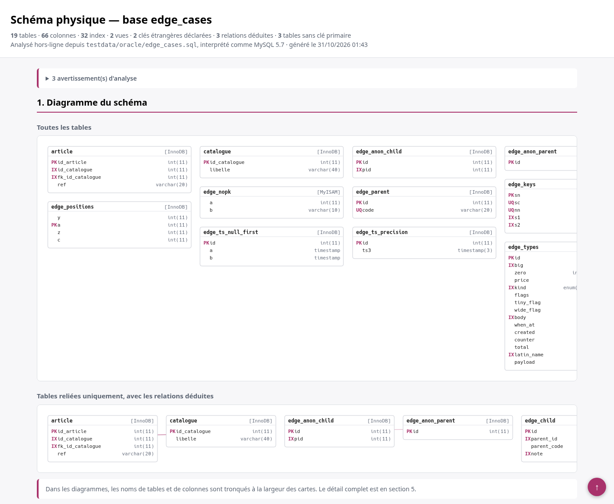
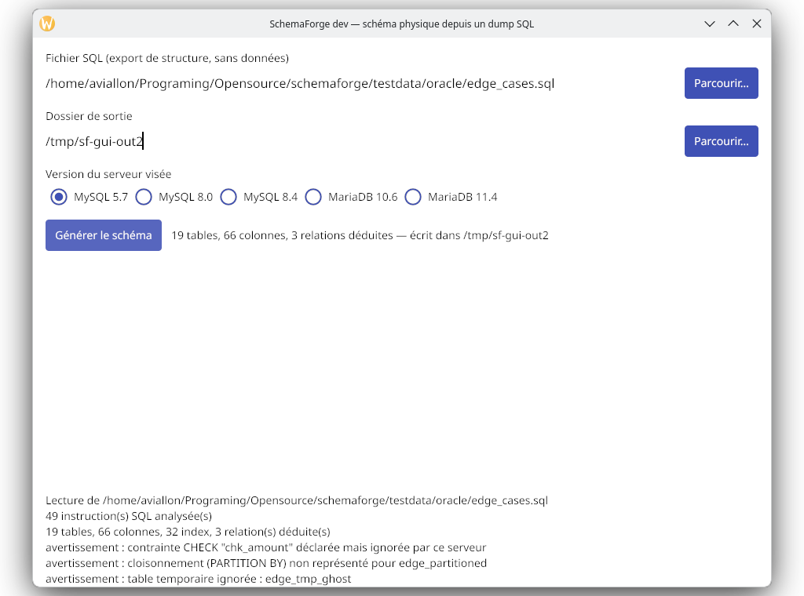

# mysql-schema-diagram

[](https://github.com/aviallon/mysql-schema-diagram/actions/workflows/ci.yml)
[](LICENSE)

**Le schéma physique d'une base MySQL/MariaDB, à partir du dump SQL seul.**

Pas de serveur à monter, pas de JVM, pas de Graphviz, pas de Python. Un binaire,
un fichier `.sql`, et un rapport lisible.



## Pourquoi

On a souvent le dump d'une base et pas la base : une sauvegarde récupérée après
incident, un `schema.sql` livré par un prestataire, un schéma client à relire
avant de l'appliquer, une base sous secret industriel qui ne peut pas sortir du
poste. Répondre à « quelles sont les relations entre ces tables ? » demande
normalement de monter un serveur, de charger le dump, puis d'interroger
`information_schema` — et d'installer en plus une JVM ou un Python pour dessiner.

Ici, tout se passe dans le binaire.

## Ce qu'il produit

| Fichier | Contenu |
| --- | --- |
| `schema_physique.html` | rapport autonome : diagramme zoomable, relations, détail de chaque table (types, NULL, défauts, index) |
| `schema.json` | le catalogue complet, pour scripter par-dessus |
| `schema.svg` | le diagramme seul |
| `relations.svg` | les tables reliées, avec les liens |

Le rapport HTML n'a besoin d'aucune ressource externe : il s'ouvre hors-ligne,
en pièce jointe, n'importe où.

## Installation

Binaires Windows, Linux et macOS sur la [page des
releases](https://github.com/aviallon/mysql-schema-diagram/releases). Le CLI
Linux est lié statiquement.

Avec Nix :

```console
$ nix run github:aviallon/mysql-schema-diagram -- -i dump.sql -o rapport/
$ nix build github:aviallon/mysql-schema-diagram#gui      # interface graphique Linux
```

Depuis les sources :

```console
$ git clone https://github.com/aviallon/mysql-schema-diagram
$ cd mysql-schema-diagram && nix develop
$ make build
```

## Utilisation

```console
$ mysql-schema-diagram -i export.sql -o rapport/
$ mysql-schema-diagram -i export.sql -o rapport/ -dialect mysql-8.0
$ mysql-schema-diagram -list-dialects
```

L'interface graphique fait la même chose en trois champs — fichier, dossier de
sortie, version du serveur :



## Versions de serveur

Un même DDL ne se lit pas de la même façon partout, et le détail compte :

```
mysql-5.7      MySQL 5.7      (défaut)
mysql-8.0      MySQL 8.0
mysql-8.4      MySQL 8.4
mariadb-10.6   MariaDB 10.6
mariadb-11.4   MariaDB 11.4
```

L'option change réellement la sortie : premier `TIMESTAMP` implicite, largeur
d'affichage des entiers (ignorée à partir de MySQL 8.0.19), alias `utf8` renommé
en `utf8mb3`, contraintes `CHECK` appliquées ou seulement enregistrées,
collation par défaut de `utf8mb4`.

## Les relations déduites

Beaucoup de dumps ne contiennent **aucune** contrainte `FOREIGN KEY` :
l'intégrité est portée par l'application. Dans ce cas l'outil propose des
relations **déduites** du nom des colonnes — `fk_id_<table>`, `id_<table>`,
`<préfixe>_<clé>` — et les présente toujours **à part** des contraintes
réellement déclarées.

Quand plusieurs tables candidates sont à égalité de confiance, **rien n'est
deviné** : la relation est refusée et listée dans les avertissements. Un lien
inventé coûte plus cher qu'un lien manquant, parce qu'il ne se voit pas.

## Limites

- **Pas de données** : seule la structure est lue, aucune statistique de volume.
- **Relations non conventionnelles invisibles** : une colonne `auteur` qui pointe
  vers `utilisateur.id` sans suivre la convention n'est pas reliée.
- **Routines, triggers et événements** ne sont pas analysés (retirés du flux et
  signalés).
- **Vues** : listées avec leur définition ; les colonnes d'un `SELECT *` restent
  indéterminées.
- **Cloisonnement (`PARTITION BY`)** non représenté, signalé par un
  avertissement.
- **Fichier lu entièrement en mémoire** : utiliser un dump de structure
  (`mysqldump --no-data`), pas un dump avec les données.
- La **GUI Linux** n'est pas publiée en binaire : elle exige cgo (X11, Wayland,
  Vulkan), donc elle est fournie par le flake. La GUI Windows, elle, est un
  `.exe` unique sans DLL hôte.

## Développement

```console
$ nix develop -c make test      # go vet + tests
$ nix develop -c make verify    # + cross Windows + porte de staticité + garde
$ nix develop -c make oracle    # régénère l'oracle depuis un vrai MariaDB
```

La fidélité est vérifiée contre un **vrai MariaDB** : la suite compare champ par
champ le catalogue hors-ligne à `information_schema` (type, nullabilité, clé,
défaut, `extra`, charset, collation, expression générée, commentaire), index et
clés étrangères compris. Les écarts tolérés sont listés dans le code, et il est
vide.

Les fixtures commitées sont **synthétiques**. Un dump de production vit hors du
dépôt (`MYSQL_SCHEMA_DIAGRAM_ORACLE_DIR`) et `tools/leakguard` refuse qu'un de ses
identifiants entre dans le contenu versionné.

### Compilation Windows

```console
$ make cross        # dist/*.exe, Go pur, aucune DLL hôte
```

La GUI Windows est construite avec un petit correctif de compatibilité Wine :
Gio traite `EnableMouseInPointer` comme fatal, alors que Wine n'en fournit qu'un
stub. Sans lui, la fenêtre ne s'ouvre pas sous Wine. Détail dans
[docs/wine.md](docs/wine.md).

## Licence

MIT — voir [LICENSE](LICENSE).
